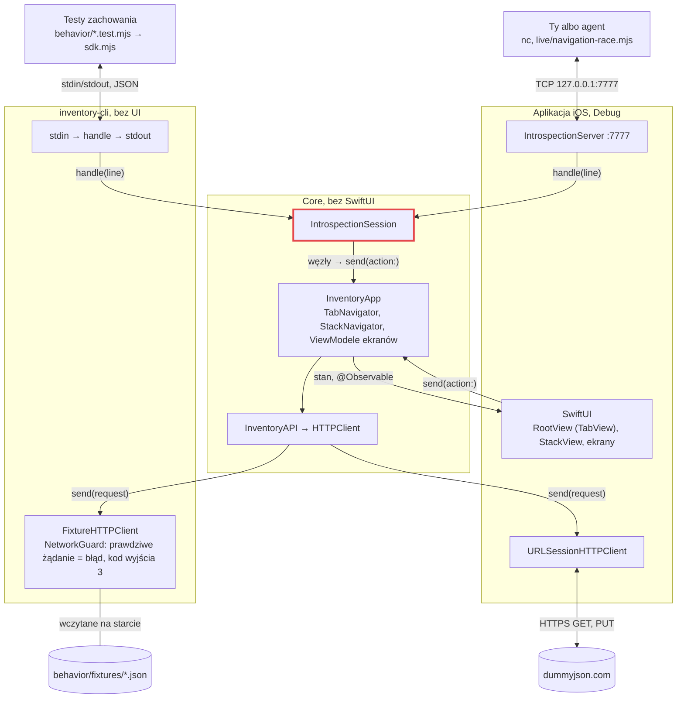
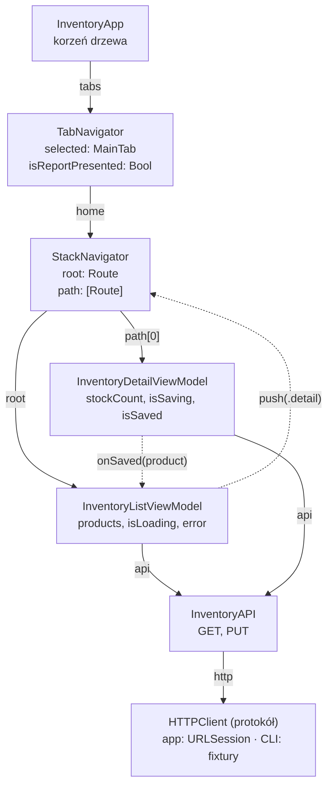
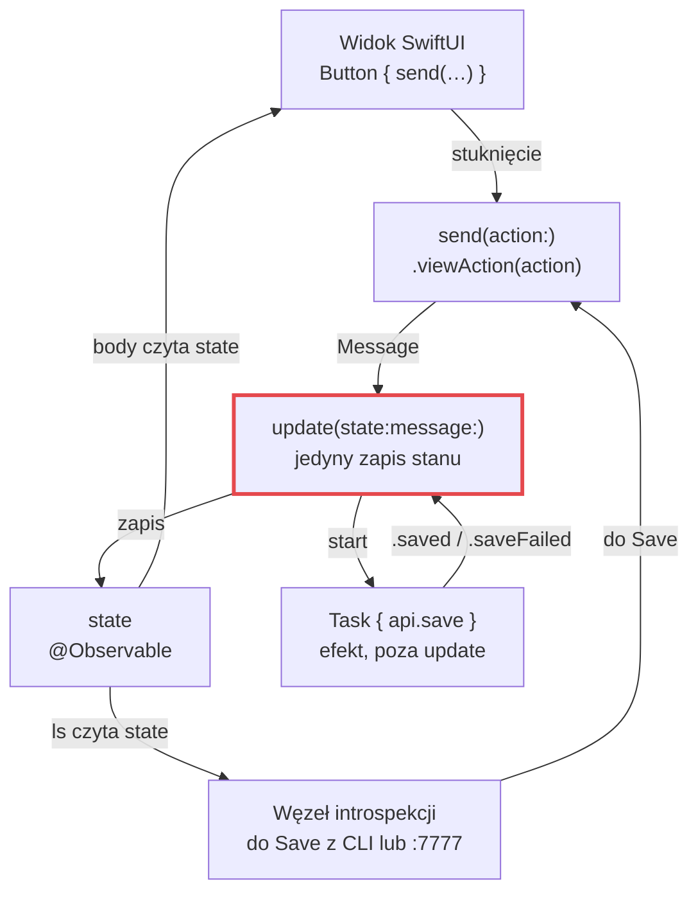
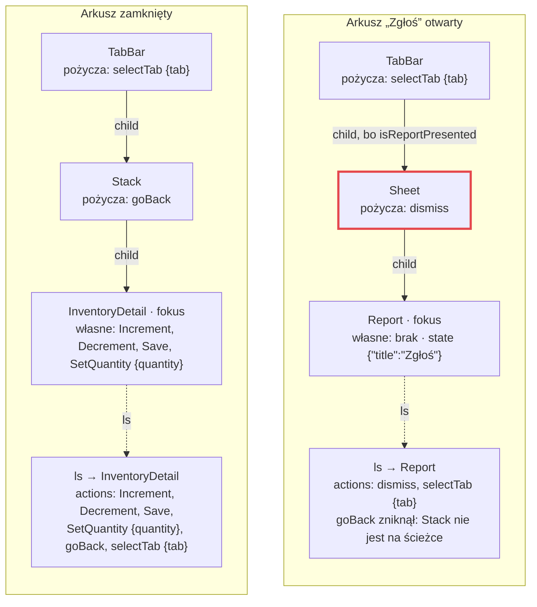
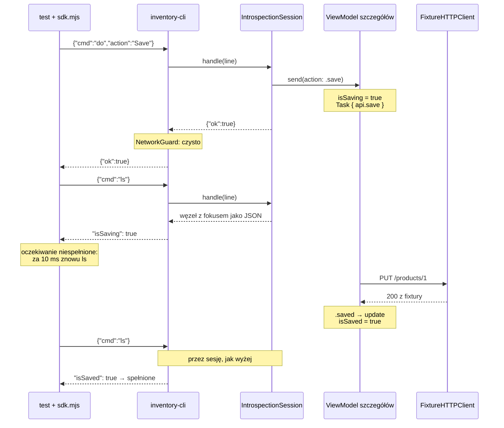
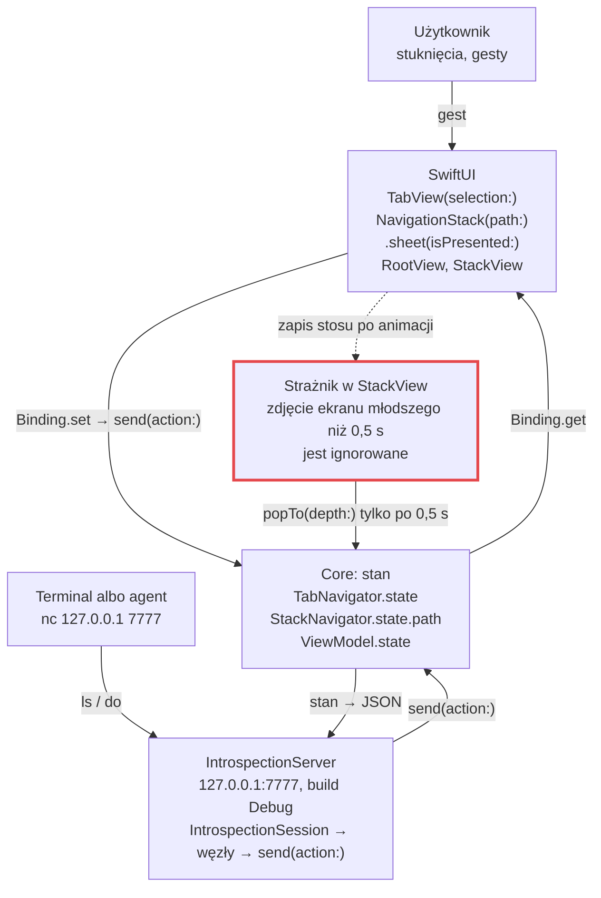

# ReflexArchitecture od środka

*Prototyp architektury · iOS · Swift 6*

ReflexArchitecture to mała aplikacja iOS zbudowana po to, żeby sprawdzić w praktyce [architekturę Reflex opisaną przez Shopify](https://shopify.engineering/reflex). Logika aplikacji działa bez ekranu, każdy ekran widać z zewnątrz jako stan w JSON z listą akcji, a testy sterują aplikacją z terminala. Poniżej: gdzie co leży, jak działa każda warstwa i co dzieje się w kodzie krok po kroku. Wszystkie fragmenty kodu i wyniki testów pochodzą z repozytorium.

- Stan kodu: `main` @ `dfc6066`
- Przykład: magazyn z DummyJSON i tab bar z ~/TabBar
- 8 testów Swift · 14 testów w Node

## Cztery filary

| Filar | Na czym polega | Gdzie |
| --- | --- | --- |
| **Core bez UI** | Cała logika siedzi w pakiecie Swift, który nie importuje SwiftUI ani UIKit. Buduje się zwykłym `swift build` i działa w procesie w terminalu. | [`Core/Sources/InventoryCore`](Core/Sources/InventoryCore) |
| **ViewModel jak w Elm** | Ekran to `State`, `Action`, `Message` i jedna funkcja `update`, która jako jedyna zmienia stan. | [`ViewModel.swift`](Core/Sources/InventoryCore/ViewModel.swift) |
| **Węzły introspekcji** | Każdy ekran widać z zewnątrz jako nazwę, stan w JSON i listę akcji. Kontenery dokładają swoje akcje ekranowi na wierzchu. | [`Core/Sources/IntrospectionKit`](Core/Sources/IntrospectionKit) |
| **CLI i testy zachowania** | Komendy `ls` i `do` sterują aplikacją bez ekranu w testach, a przez port 7777 także działającą aplikacją w symulatorze. | [`behavior/`](behavior) · [`Core/Sources/InventoryCLI`](Core/Sources/InventoryCLI) |

## Spis treści

1. [Co gdzie leży](#1-co-gdzie-leży)
2. [Core bez UI](#2-core-bez-ui)
3. [ViewModel: jedno wejście, jeden zapis](#3-viewmodel-jedno-wejście-jeden-zapis)
4. [Węzły introspekcji](#4-węzły-introspekcji)
5. [CLI i testy zachowania](#5-cli-i-testy-zachowania)
6. [Ta sama aplikacja na żywo](#6-ta-sama-aplikacja-na-żywo)
7. [Proces krok po kroku: tab bar](#7-proces-krok-po-kroku-tab-bar)
8. [Liczby](#8-liczby)
9. [Granice prototypu](#9-granice-prototypu)
10. [Ściągawka](#10-ściągawka)

## 1. Co gdzie leży

Repozytorium ma trzy części. Zależności idą w jedną stronę: aplikacja iOS i CLI zależą od Core, a Core nie zależy od niczego, co rysuje ekran.

```text
ReflexArchitecture/
├── Core/                              pakiet SwiftPM, zero UI
│   ├── Sources/IntrospectionKit/      kontrakt: węzeł, akcja, sesja ls/do, serwer :7777
│   ├── Sources/InventoryCore/         logika: ViewModele, nawigatory, API, korzeń aplikacji
│   ├── Sources/InventoryCLI/          host bez UI: stdin/stdout, fixtury, strażnik sieci
│   └── Tests/                         8 testów Swift samego kontraktu
├── Mobile/                            aplikacja iOS: widoki SwiftUI i start serwera
├── behavior/                          testy w Node, bez żadnych zależności
│   ├── sdk.mjs                        sesja testowa: precondition, do, close
│   ├── inventory.test.mjs             8 podróży po magazynie
│   ├── tabs.test.mjs                  5 podróży po tab barze
│   ├── sdk.test.mjs                   1 test samego SDK
│   ├── fixtures/*.json                odpowiedzi „sieci” dla CLI
│   └── live/navigation-race.mjs       ręczny test żywej aplikacji
├── cli                                uruchamia aplikację bez UI
├── test                               uruchamia wszystkie testy
└── .claude/skills/reflex/SKILL.md     instrukcja dla agentów
```



**Rys. 1.** Ten sam Core budują dwa hosty. CLI podaje mu odpowiedzi z plików i rozmawia przez stdin/stdout. Aplikacja podaje mu prawdziwą sieć i słucha na porcie 7777. Wejście do Core jest w obu przypadkach to samo: `IntrospectionSession.handle(line)`.

Granic pilnuje kompilator. `Core/Package.swift` wystawia trzy produkty. Aplikacja iOS dołącza tylko dwie biblioteki, a CLI jest osobnym programem:

[`Core/Package.swift`](Core/Package.swift) (fragment)

```swift
let settings: [SwiftSetting] = [
    .defaultIsolation(MainActor.self),
    .enableUpcomingFeature("NonisolatedNonsendingByDefault"),
    .enableUpcomingFeature("InferIsolatedConformances"),
]
…
    products: [
        .library(name: "IntrospectionKit", targets: ["IntrospectionKit"]),
        .library(name: "InventoryCore", targets: ["InventoryCore"]),
        .executable(name: "inventory-cli", targets: ["InventoryCLI"]),
    ],
```

Cały pakiet domyślnie działa na głównym aktorze (`defaultIsolation(MainActor.self)`). ViewModele i tak żyją na wątku głównym, więc nie trzeba ich oznaczać. Jako `nonisolated` oznaczone są tylko typy wartości, które przechodzą między wątkami, np. `Product` i dane wejściowe akcji.

## 2. Core bez UI

Korzeniem aplikacji jest `InventoryApp`. Buduje drzewo obiektów i przyjmuje z zewnątrz tylko jedną rzecz: `HTTPClient`, czyli krawędź sieci.

[`Core/Sources/InventoryCore/InventoryApp.swift`](Core/Sources/InventoryCore/InventoryApp.swift)

```swift
/// The root of the app's object tree. The iOS app and the CLI are two hosts that construct it.
public final class InventoryApp {
    public let tabs: TabNavigator

    public init(http: any HTTPClient) {
        let api = InventoryAPI(http: http)
        weak var stack: StackNavigator?
        let list = InventoryListViewModel(api: api) { stack?.push($0) }
        let home = StackNavigator(root: .list(list))
        stack = home
        tabs = TabNavigator(home: home)
    }
}
```

Oba hosty budują ten sam korzeń. Różnią się klientem HTTP i tym, kto czyta stan: w aplikacji robi to SwiftUI, w CLI sesja tekstowa.

[`Mobile/ReflexArchitectureApp.swift`](Mobile/ReflexArchitectureApp.swift) (fragment)

```swift
@State private var app = InventoryApp(http: URLSessionHTTPClient())
…
WindowGroup {
    RootView(tabs: app.tabs)
    …
}
```

[`Core/Sources/InventoryCLI/CLI.swift`](Core/Sources/InventoryCLI/CLI.swift) (fragment)

```swift
NetworkGuard.install()
let session = IntrospectionSession(
    root: InventoryApp(http: FixtureHTTPClient(fixtures: fixtures)))
```



**Rys. 2.** Drzewo obiektów po otwarciu szczegółów produktu. Linia ciągła: obiekt trzyma referencję. Linia przerywana: wywołanie zwrotne (closure). Lista nie zna nawigatora, dostaje tylko funkcję `push`. Ekran szczegółów nie zna listy, dostaje tylko `onSaved`. Zaślepki zakładek i arkusz „Zgłoś” nie są obiektami: ich węzły powstają ze stanu `TabNavigator`.

Dwie decyzje sprawiają, że ten sam kod działa bez ekranu.

- **Nawigacja to stan Core.** `StackNavigator` trzyma ścieżkę ekranów, a `TabNavigator` wybraną zakładkę i to, czy arkusz „Zgłoś” jest otwarty. Widok nigdy sam niczego nie otwiera, tylko wysyła akcję.
- **Nic nie czeka na cykl życia widoku.** Lista zaczyna ładowanie w `init`, a nie w `onAppear`. W terminalu nie ma `onAppear`, więc gdyby ładowanie od niego zależało, CLI nigdy by go nie uruchomiło.

[`Core/Sources/InventoryCore/InventoryListViewModel.swift`](Core/Sources/InventoryCore/InventoryListViewModel.swift) (fragment)

```swift
/// Starts loading right away: no view lifecycle involved, so headless runs behave the same.
init(api: InventoryAPI, push: @escaping (Route) -> Void) {
    self.api = api
    self.push = push
    send(message: .load)
}
```

## 3. ViewModel: jedno wejście, jeden zapis

Każdy ekran i każdy nawigator ma ten sam kształt. Opisuje go krótki protokół:

[`Core/Sources/InventoryCore/ViewModel.swift`](Core/Sources/InventoryCore/ViewModel.swift)

```swift
/// The one shape every screen (and the navigator) follows: actions in, state out.
///
/// - `State` holds everything the screen shows; views read it and nothing else.
/// - `Action` is the public surface, sent through `send(action:)`.
/// - `Message` is internal: `.viewAction(Action)` plus results coming back from services.
/// - `update(state:message:)` is the only writer of `state`. Effects start a `Task`
///   that reports back with `send(message:)`. `update` never reads `self.state`.
@MainActor protocol ViewModel: AnyObject {
    associatedtype State
    associatedtype Message
    var state: State { get set }
    func update(state: inout State, message: Message)
}

extension ViewModel {
    func send(message: Message) {
        update(state: &state, message: message)
    }
}
```



**Rys. 3.** Widok i węzeł introspekcji wchodzą tymi samymi drzwiami: `send(action:)`. Stan zmienia tylko `update`. Efekt, czyli zapis na serwerze, działa w `Task` i wraca do `update` jako nowa wiadomość.

Tak wygląda to w ekranie szczegółów produktu:

[`Core/Sources/InventoryCore/InventoryDetailViewModel.swift`](Core/Sources/InventoryCore/InventoryDetailViewModel.swift) (fragment)

```swift
public struct State: Encodable {
    public let productId: Int
    public let title: String
    public var stockCount: Int
    public var isSaving = false
    public var isSaved = false
    public var error: String?
}

public enum Action {
    case increment, decrement, save
    case setQuantity(Int)
}

enum Message {
    case viewAction(Action)
    case saved
    case saveFailed
}
…
func update(state: inout State, message: Message) {
    switch message {
    case .viewAction(let action):
        guard !state.isSaving else { return }  // nothing changes while a save is in flight
        switch action {
        // Wrapping on purpose: stock from the backend can be Int.max/Int.min; the wrapped
        // result lands outside stockRange, so edit(_:to:) turns it into a no-op.
        case .increment: Self.edit(&state, to: state.stockCount &+ 1)
        case .decrement: Self.edit(&state, to: state.stockCount &- 1)
        case .setQuantity(let quantity): Self.edit(&state, to: quantity)
        case .save:
            state.isSaving = true
            state.error = nil
            let (id, stock) = (state.productId, state.stockCount)
            Task {
                do {
                    try await api.save(id: id, stock: stock)
                    send(message: .saved)
                } catch {
                    send(message: .saveFailed)
                }
            }
        }
    case .saved:
        state.isSaving = false
        state.isSaved = true
        onSaved(Product(id: state.productId, title: state.title, stock: state.stockCount))
    case .saveFailed:
        state.isSaving = false
        state.error = "Couldn't save"
    }
}
```

### Co się dzieje po naciśnięciu Save

1. Przycisk w widoku woła `viewModel.send(action: .save)`. Test robi dokładnie to samo przez akcję `Save` węzła.
2. `send(action:)` opakowuje akcję w `Message.viewAction(.save)` i woła `update`.
3. `update` ustawia `isSaving = true`, czyści błąd i uruchamia `Task`, który wywołuje `api.save(id:stock:)`.
4. Odpowiedź serwera wraca jako nowa wiadomość, `.saved` albo `.saveFailed`, i znowu przechodzi przez `update`.
5. Przy `.saved` stan dostaje `isSaved = true`, a `onSaved` przekazuje nową liczbę liście. Po powrocie lista pokazuje już zapisaną wartość.

Przypadki brzegowe rozstrzyga `update`, nigdy widok ani węzeł. W trakcie zapisu edycje nic nie robią (`guard !state.isSaving`). Liczba spoza zakresu 0–999&nbsp;999 jest ignorowana, a `&+` i `&-` chronią przed przepełnieniem, gdy backend zwróci `Int.max`. Każdą z tych reguł sprawdza osobna podróż w [`behavior/inventory.test.mjs`](behavior/inventory.test.mjs).

Widok tylko czyta stan i wysyła akcje. Jedyny lokalny stan widoku to bufor wpisywanej liczby:

[`Mobile/InventoryDetailView.swift`](Mobile/InventoryDetailView.swift) (fragment)

```swift
struct InventoryDetailView: View {
    let viewModel: InventoryDetailViewModel
    @State private var quantity = ""  // the typing buffer, the only view-local state

    var body: some View {
        let state = viewModel.state
        Form {
            Section("Stock") {
                HStack {
                    Button("Decrease", systemImage: "minus.circle") { viewModel.send(action: .decrement) }
                    Spacer()
                    Text(state.stockCount, format: .number).font(.largeTitle.monospacedDigit())
                    Spacer()
                    Button("Increase", systemImage: "plus.circle") { viewModel.send(action: .increment) }
                }
                …
            }
            Section {
                Button("Save") { viewModel.send(action: .save) }
                    .disabled(state.isSaving)
                …
```

## 4. Węzły introspekcji

Węzeł to ekran widziany z zewnątrz: nazwa, stan, który da się zakodować jako JSON, lista akcji i opcjonalnie węzeł pod spodem.

[`Core/Sources/IntrospectionKit/IntrospectionNode.swift`](Core/Sources/IntrospectionKit/IntrospectionNode.swift) (fragment)

```swift
/// A screen (or a container of screens) seen from outside the app:
/// a name, its state as JSON, the actions it accepts, and the node below it.
@MainActor public protocol IntrospectionNode {
    var name: String { get }
    var state: any Encodable { get }
    var actions: [IntrospectionAction] { get }
    var child: (any IntrospectionNode)? { get }
}
```

Ekran szczegółów wystawia swój stan bez zmian i po jednej akcji na każdy przypadek `Action`:

[`Core/Sources/InventoryCore/InventoryDetailViewModel+Introspection.swift`](Core/Sources/InventoryCore/InventoryDetailViewModel+Introspection.swift)

```swift
extension InventoryDetailViewModel: IntrospectionProviding {
    public var introspectionNode: any IntrospectionNode { Node(viewModel: self) }

    private struct Node: IntrospectionNode {
        let viewModel: InventoryDetailViewModel
        let name = "InventoryDetail"
        var state: any Encodable { viewModel.state }
        var actions: [IntrospectionAction] {
            [
                IntrospectionAction("Increment") { viewModel.send(action: .increment) },
                IntrospectionAction("Decrement") { viewModel.send(action: .decrement) },
                IntrospectionAction("Save") { viewModel.send(action: .save) },
                IntrospectionAction("SetQuantity", input: SetQuantityInput.self) {
                    viewModel.send(action: .setQuantity($0.quantity))
                },
            ]
        }
    }
}

nonisolated struct SetQuantityInput: IntrospectionInput {
    let quantity: Int
    static let fields = ["quantity"]
}
```

> **Reguły węzła.** Jeśli użytkownik coś widzi, jest to w stanie. Jeśli może coś zrobić, jest to akcja. Każda akcja jest na liście zawsze, bez `if`, i tylko woła `send(action:)`. Czy akcja coś zmieni, rozstrzyga `update`.

### Kontenery pożyczają akcje

Nawigatory też są węzłami, ale nie mają własnego ekranu. Ich akcje są pisane małą literą (`goBack`, `selectTab`, `dismiss`), bo trafiają do ekranu na wierzchu jako pożyczone. Pole `child` mówi, co jest pod spodem. W tab barze zależy to od stanu:

[`Core/Sources/InventoryCore/TabNavigator+Introspection.swift`](Core/Sources/InventoryCore/TabNavigator+Introspection.swift) (fragment)

```swift
private struct Node: IntrospectionNode {
    let navigator: TabNavigator
    let name = "TabBar"
    var state: any Encodable { navigator.state }
    var actions: [IntrospectionAction] {
        [
            IntrospectionAction("selectTab", input: SelectTabInput.self) {
                navigator.send(action: .selectTab($0.tab))
            },
        ]
    }
    var child: (any IntrospectionNode)? {
        if navigator.state.isReportPresented { return Sheet(navigator: navigator) }
        let tab = navigator.state.selected
        return tab == .home ? navigator.home.introspectionNode : Placeholder(tab: tab)
    }
}

/// Lends dismiss to the report, so dismiss exists only while the sheet is up.
private struct Sheet: IntrospectionNode {
    let navigator: TabNavigator
    let name = "Sheet"
    var state: any Encodable { [String: String]() }
    var actions: [IntrospectionAction] {
        [IntrospectionAction("dismiss") { navigator.send(action: .dismissReport) }]
    }
    var child: (any IntrospectionNode)? { Placeholder(tab: .report) }
}
```

Sesja schodzi po `child` aż do najgłębszego węzła. Ten węzeł ma fokus: jego nazwę i stan pokazuje `ls`. Akcje są zbierane z całej ścieżki, najpierw własne, potem rodziców od najbliższego:

[`Core/Sources/IntrospectionKit/IntrospectionSession.swift`](Core/Sources/IntrospectionKit/IntrospectionSession.swift) (fragment)

```swift
/// The deepest node, and every action available there: its own first,
/// then each ancestor's, nearest first; a title already taken is skipped.
private func focus() -> (node: any IntrospectionNode, actions: [IntrospectionAction]) {
    var chain = [root.introspectionNode]
    while let child = chain[chain.count - 1].child { chain.append(child) }
    var taken = Set<String>()
    let actions = chain.reversed().flatMap(\.actions).filter { taken.insert($0.title).inserted }
    return (chain[chain.count - 1], actions)
}
```



**Rys. 4.** Ta sama aplikacja przed otwarciem arkusza „Zgłoś” (po `do SelectProduct {"id":1}`) i po nim (po `do selectTab {"tab":"report"}`). Zmienia się jedna rzecz: `child` tab bara. Razem z nią znika `goBack`, a pojawia się `dismiss`, choć na żadnej liście akcji nie ma `if`.

### Dane wejściowe akcji

Akcja z danymi dostaje obiekt JSON i dekoduje go do typu `IntrospectionInput`. Złe dane kończą się błędem, zanim dotrą do ViewModelu. Dla zakładek błąd od razu podaje poprawne wartości:

[`Core/Sources/InventoryCore/TabNavigator+Introspection.swift`](Core/Sources/InventoryCore/TabNavigator+Introspection.swift) (fragment)

```swift
nonisolated struct SelectTabInput: IntrospectionInput {
    let tab: MainTab
    static let fields = ["tab"]

    private enum CodingKeys: CodingKey { case tab }

    /// An unknown tab is refused with the list of tabs, so whoever sent it can correct it.
    init(from decoder: any Decoder) throws {
        let container = try decoder.container(keyedBy: CodingKeys.self)
        let name = try container.decode(String.self, forKey: .tab)
        guard let tab = MainTab(rawValue: name) else {
            let tabs = MainTab.allCases.map(\.rawValue).joined(separator: ", ")
            throw DecodingError.dataCorruptedError(
                forKey: .tab, in: container, debugDescription: #"unknown tab "\#(name)"; tabs: \#(tabs)"#)
        }
        self.tab = tab
    }
}
```

```text
do selectTab {"tab":"settings"}
error: selectTab expects {tab}: unknown tab "settings"; tabs: home, search, favorites, profile, report
```

## 5. CLI i testy zachowania

### Protokół: dwie komendy

`ls` pokazuje ekran z fokusem. `do <Akcja> [json]` wykonuje jedną z akcji, które `ls` właśnie pokazał. Linia tekstu dostaje odpowiedź do czytania:

```console
$ printf 'ls\ndo SelectProduct {"id":1}\ndo selectTab {"tab":"report"}\nls\ndo dismiss\nls\n' | ./cli
InventoryList
  state   {"isLoading":false,"products":[{"id":1,"stock":99,"title":"Essence Mascara Lash Princess"},…]}
  actions SelectProduct {id}, goBack, selectTab {tab}
ok
ok
Report
  state   {"title":"Zgłoś"}
  actions dismiss, selectTab {tab}
ok
InventoryDetail
  state   {"isSaved":false,"isSaving":false,"productId":1,"stockCount":99,"title":"Essence Mascara Lash Princess"}
  actions Increment, Decrement, Save, SetQuantity {quantity}, goBack, selectTab {tab}
```

Linia zaczynająca się od `{` to zapytanie JSON. Dostaje odpowiedź w jednej linii JSON i tego trybu używają testy:

```text
{"cmd":"ls"}
{"actions":[{"fields":["id"],"title":"SelectProduct"},{"fields":[],"title":"goBack"},{"fields":["tab"],"title":"selectTab"}],"name":"InventoryList","state":{"isLoading":false,"products":[{"id":1,"stock":2,"title":"Essence Mascara Lash Princess"}]}}
{"cmd":"do","action":"SelectProduct","payload":{"id":1}}
{"ok":true}
```

### Host bez UI

`inventory-cli` czyta komendy ze stdin i każdą odpowiedź od razu wypisuje na stdout. Czytanie jest asynchroniczne, więc między komendami mogą działać efekty, np. zapis na serwerze:

[`Core/Sources/InventoryCLI/CLI.swift`](Core/Sources/InventoryCLI/CLI.swift) (fragment)

```swift
NetworkGuard.install()
let session = IntrospectionSession(root: InventoryApp(http: FixtureHTTPClient(fixtures: fixtures)))
// Async reading lets effects (service Tasks) run between commands.
for try await line in FileHandle.standardInput.bytes.lines
where !line.trimmingCharacters(in: .whitespaces).isEmpty {
    let answer = session.handle(line)
    let violations = NetworkGuard.violations
    if !violations.isEmpty {
        fail(violations.map { "network violation: \($0)" }.joined(separator: "\n"), code: 3)
    }
    // Unbuffered on purpose: a piped stdout would otherwise hold answers back.
    FileHandle.standardOutput.write(Data((answer + "\n").utf8))
}
```

Sieć zastępują fixtury. Kluczem jest metoda i ścieżka z zapytaniem, wartością status, opcjonalnie treść i opóźnienie. Test ładuje kilka małych plików naraz, a przy tym samym kluczu wygrywa późniejszy:

[`behavior/fixtures/Inventory.stockCount2.json`](behavior/fixtures/Inventory.stockCount2.json)

```json
{
  "GET /products?limit=20&select=title,stock": {
    "status": 200,
    "body": { "products": [{ "id": 1, "title": "Essence Mascara Lash Princess", "stock": 2 }], "total": 1, "skip": 0, "limit": 20 }
  }
}
```

[`behavior/fixtures/Inventory.saveSlow.json`](behavior/fixtures/Inventory.saveSlow.json)

```json
{ "PUT /products/1": { "status": 200, "delayMs": 500 } }
```

Zero sieci jest wymuszone. `NetworkGuard` przechwytuje każde prawdziwe żądanie, a `FixtureHTTPClient` zapisuje każde żądanie, dla którego nie ma fixtury. CLI kończy wtedy pracę z kodem 3, nawet jeśli aplikacja obsłużyła błąd:

```console
$ printf 'do SelectProduct {"id":1}\ndo Save\nls\n' | ./cli behavior/fixtures/Inventory.stockCount2.json
ok
ok
network violation: missing fixture: PUT /products/1
$ echo $?
3
```

### SDK testów

[`behavior/sdk.mjs`](behavior/sdk.mjs) uruchamia CLI jako proces potomny i rozmawia z nim w JSON. Nie ma żadnych zależności poza Node. Testy używają trzech metod:

- `precondition(name, check)` czeka, aż ekran z fokusem będzie miał tę nazwę i spełni warunek.
- `do({ action, payload, expectation })` wykonuje akcję, a potem co 10 ms pyta `ls`, aż oczekiwanie przestanie rzucać błąd. Po 2 s test pada i pokazuje ostatni widziany stan.
- `close()` pyta CLI jeszcze raz, żeby naruszenie sieci spowodowane ostatnim krokiem też oblało test.

[`behavior/sdk.mjs`](behavior/sdk.mjs) (fragment)

```javascript
// Polls ls until check(node) stops throwing. A dead process fails at once (ls rejects);
// only failures thrown by the check are retried.
async function until(check) {
  const deadline = Date.now() + TIMEOUT_MS;
  for (;;) {
    const node = await ls();
    try {
      check(node);
      return node;
    } catch (error) {
      if (Date.now() >= deadline) {
        error.message += `\nlast seen: ${JSON.stringify(node)}`;
        throw error;
      }
    }
    await new Promise((resolve) => setTimeout(resolve, POLL_MS));
  }
}
…
  async do({ action, payload, expectation }) {
    const answer = await request({ cmd: 'do', action, payload });
    if (answer.error) throw new Error(`do ${action} refused: ${answer.error}`);
    if (expectation) await until(expectation);
  },
```

### Test od środka

Pierwsza podróż w [`behavior/inventory.test.mjs`](behavior/inventory.test.mjs) przechodzi całą ścieżkę zapisu. Fixtury `stockCount2` i `saveSucceeds` dają jeden produkt ze stanem 2 i udany `PUT`:

[`behavior/inventory.test.mjs`](behavior/inventory.test.mjs) (fragment)

```javascript
// Every journey starts on the loaded list and opens one product.
async function openInventoryDetail(session, id = 1) {
  await session.precondition('InventoryList', ({ state }) => assert.equal(state.isLoading, false));
  await session.do({
    action: 'SelectProduct',
    payload: { id },
    expectation: ({ name, state }) => {
      assert.equal(name, 'InventoryDetail');
      assert.equal(state.productId, id);
    },
  });
}

test('given save succeeds, the user can adjust the quantity and save it', async (t) => {
  const session = createBehaviorSession({
    fixtures: [fixture('Inventory.stockCount2'), fixture('Inventory.saveSucceeds')],
  });
  t.after(() => session.close());
  await openInventoryDetail(session);

  await session.do({ action: 'Decrement', expectation: ({ state }) => assert.equal(state.stockCount, 1) });
  await session.do({ action: 'Decrement', expectation: ({ state }) => assert.equal(state.stockCount, 0) });
  // Decrement is always listed; the ViewModel decides it does nothing at zero
  await session.do({ action: 'Decrement', expectation: ({ state }) => assert.equal(state.stockCount, 0) });
  await session.do({
    action: 'SetQuantity',
    payload: { quantity: 40 },
    expectation: ({ state }) => assert.equal(state.stockCount, 40),
  });
  await session.do({ action: 'Save', expectation: ({ state }) => assert.equal(state.isSaved, true) });
  // any edit after a save makes the screen unsaved again
  await session.do({
    action: 'Increment',
    expectation: ({ state }) => {
      assert.equal(state.stockCount, 41);
      assert.equal(state.isSaved, false);
    },
  });
  await session.do({ action: 'Save', expectation: ({ state }) => assert.equal(state.isSaved, true) });
  // back on the list, the product shows what was saved
  await session.do({
    action: 'goBack',
    expectation: ({ name, state }) => {
      assert.equal(name, 'InventoryList');
      assert.equal(state.products.find((p) => p.id === 1).stock, 41);
    },
  });
});
```

Krok `Save` z tej podróży wygląda w środku tak:



**Rys. 5.** Jeden krok `session.do({ action: 'Save', … })`. Odpowiedź `ok` znaczy tylko, że akcję przyjęto. O wyniku decyduje oczekiwanie, które SDK sprawdza, ponawiając `ls`. Kolejność bywa różna: bez opóźnienia w fixturze zapis zwykle kończy się jeszcze przed pierwszym `ls`. Test tego nie zakłada, po prostu pyta do skutku.

## 6. Ta sama aplikacja na żywo

W buildzie Debug aplikacja uruchamia `IntrospectionServer`. Pod spodem jest ten sam `IntrospectionSession` co w CLI, tylko komendy przychodzą po TCP. Trafiają do ViewModeli działającej aplikacji, więc ekran od razu pokazuje ich skutek.

[`Core/Sources/IntrospectionKit/IntrospectionServer.swift`](Core/Sources/IntrospectionKit/IntrospectionServer.swift) (fragment)

```swift
public init(port: UInt16, session: IntrospectionSession) throws {
    // Loopback only: reachable from this Mac (a simulator shares its network), never from the LAN.
    // acceptLocalOnly would be the obvious knob, but the iOS simulator silently drops those
    // connections (its NECP setup fails: "SO_NECP_LISTENUUID failed").
    let parameters = NWParameters.tcp
    parameters.requiredLocalEndpoint = .hostPort(host: .ipv4(.loopback), port: NWEndpoint.Port(rawValue: port)!)
    listener = try NWListener(using: parameters)
    self.session = session
}
```

[`Mobile/ReflexArchitectureApp.swift`](Mobile/ReflexArchitectureApp.swift) (fragment)

```swift
#if DEBUG
/// `nc localhost 7777` gives the same ls/do as the headless CLI, against the running app.
private func startServer() {
    guard server == nil else { return }
    do {
        server = try IntrospectionServer(port: 7777, session: IntrospectionSession(root: app))
        server?.start()
    } catch {
        print("IntrospectionServer could not start: \(error)")
    }
}
#endif
```

```console
$ printf 'do SelectProduct {"id":2}\ndo selectTab {"tab":"report"}\nls\n' | nc -w 1 127.0.0.1 7777
ok
ok
Report
  state   {"title":"Zgłoś"}
  actions dismiss, selectTab {tab}
```

W symulatorze otwierają się wtedy szczegóły drugiego produktu, a na nich arkusz „Zgłoś”, dokładnie jak po stuknięciach palcem.



**Rys. 6.** Stan żyje w Core. SwiftUI czyta go przez `Binding.get` i zgłasza gesty przez `Binding.set`, które wysyła akcję. Terminal wchodzi tymi samymi drzwiami przez port 7777. Jedyny filtr stoi na ścieżce stosu ekranów.

SwiftUI dostaje stan przez zwykłe `Binding`. `get` czyta Core, a `set` zamienia gest w akcję. Decyzję, co ta akcja zrobi, podejmuje Core:

[`Mobile/RootView.swift`](Mobile/RootView.swift) (fragment)

```swift
TabView(selection: Binding(get: { tabs.state.selected }, set: { tabs.send(action: .selectTab($0)) })) {
    Tab(MainTab.home.title, systemImage: MainTab.home.icon, value: MainTab.home) {
        StackView(navigator: tabs.home)
    }
    …
}
.tint(.red)
.sheet(isPresented: Binding(
    get: { tabs.state.isReportPresented },
    set: { if !$0 { tabs.send(action: .dismissReport) } }  // swiped down
)) {
    ReportSheet(tabs: tabs)
}
```

### Nieaktualne zapisy z SwiftUI

Po zakończeniu animacji SwiftUI zapisuje z powrotem stos ekranów, który pokazuje. Gdy agent wysyła akcje szybciej, niż trwają animacje, ten zapis bywa nieaktualny i zdjąłby świeżo otwarty ekran. Ręczny test [`behavior/live/navigation-race.mjs`](behavior/live/navigation-race.mjs) pokazał 2 zgubione ekrany na 30 szybkich podróży. Dlatego `StackView` ignoruje zdjęcie ekranu, który SwiftUI zna krócej niż 0,5 s:

[`Mobile/StackView.swift`](Mobile/StackView.swift) (fragment)

```swift
set: { newPath in
    // SwiftUI writes back the stack it displays when a transition ends. When Core has
    // moved on meanwhile (an agent pushing faster than the animations), that write is
    // stale. A person can only pop screens that finished coming in, so a pop that would
    // remove a screen SwiftUI learned about less than 0.5 s ago is ignored.
    // ponytail: time-based; a navigation delegate reporting only interactive pops would be exact.
    let removed = navigator.state.path.dropFirst(newPath.count)
    let settled = removed.allSatisfy { route in
        firstSeen.at[route].map { Date.now.timeIntervalSince($0) > 0.5 } ?? false
    }
    if settled { navigator.send(action: .popTo(depth: newPath.count)) }
}
```

Po tej zmianie test daje 0 zgubionych ekranów na 120 podróży, także wewnątrz tab bara. Zakładki i arkusz nie potrzebowały osobnej ochrony: 60 szybkich przełączeń zakładek i 60 otwarć arkusza przez port 7777 nie dało żadnej rozbieżności między Core a ekranem.

## 7. Proces krok po kroku: tab bar

Architekturę najlepiej widać przy dodawaniu funkcji. Tab bar powstał w poniższej kolejności. Kroki od 2 do 5 nie wymagają symulatora i każdy przebieg testów trwa poniżej sekundy.

### Krok 1. Opis zachowania

Najpierw w rozmowie: pięć zakładek jak w ~/TabBar, Home z magazynem, „Zgłoś” otwiera arkusz zamiast przełączać zakładkę, a wybraną zakładkę trzyma Core. Do tego pięć ścieżek, które mają działać.

### Krok 2. Testy przed kodem

Plik [`behavior/tabs.test.mjs`](behavior/tabs.test.mjs) opisuje te ścieżki w języku akcji. Funkcje pomocnicze i jedna z podróży:

[`behavior/tabs.test.mjs`](behavior/tabs.test.mjs) (fragment)

```javascript
function startOnHome(t) {
  const session = createBehaviorSession({ fixtures: [fixture('Inventory.stockCount2')] });
  t.after(() => session.close());
  return session;
}

const selectTab = (session, tab, expectation) => session.do({ action: 'selectTab', payload: { tab }, expectation });
…
test('Zgłoś opens the report over the current tab, and closing it returns there', async (t) => {
  const session = startOnHome(t);
  await openProduct(session);
  await selectTab(session, 'report', ({ name, state }) => {
    assert.equal(name, 'Report');
    assert.deepEqual(state, { title: 'Zgłoś' });
  });
  await session.do({
    action: 'dismiss',
    expectation: ({ name, state }) => {
      assert.equal(name, 'InventoryDetail');
      assert.equal(state.productId, 1);
    },
  });
  // the same over a placeholder tab
  await selectTab(session, 'profile', ({ name }) => assert.equal(name, 'Profile'));
  await selectTab(session, 'report', ({ name }) => assert.equal(name, 'Report'));
  await session.do({ action: 'dismiss', expectation: ({ name }) => assert.equal(name, 'Profile') });
});
```

### Krok 3. Czerwono

Testy uruchomione przed napisaniem kodu padają z właściwego powodu: akcji `selectTab` jeszcze nie ma.

```console
$ node --test behavior/tabs.test.mjs
not ok 1 - the app opens on Home, and each tab shows its own screen
  error: 'do selectTab refused: unknown action "selectTab"; available: SelectProduct {id}, goBack'
not ok 2 - switching tabs keeps Home where the user left it
  error: 'do selectTab refused: unknown action "selectTab"; available: Increment, Decrement, Save, SetQuantity {quantity}, goBack'
…
# pass 0
# fail 5
```

### Krok 4. Logika w Core

`TabNavigator` dostaje stan, akcje i `update`, a reguły z opisu trafiają do `update`. Węzeł tab bara pokazany był wyżej, w części o węzłach.

[`Core/Sources/InventoryCore/TabNavigator.swift`](Core/Sources/InventoryCore/TabNavigator.swift) (fragment)

```swift
func update(state: inout State, message: Message) {
    switch message {
    case .viewAction(.selectTab(let tab)):
        guard !state.isReportPresented else { return }  // the sheet covers the tab bar
        if tab == .report {
            state.isReportPresented = true
        } else if tab != state.selected {
            state.selected = tab
        } else if tab == .home {
            home.send(action: .popTo(depth: 0))  // the selected tab tapped again: back to its first screen
        }
    case .viewAction(.dismissReport):
        state.isReportPresented = false
    }
}
```

### Krok 5. Zielono

```console
$ node --test behavior/tabs.test.mjs
ok 1 - the app opens on Home, and each tab shows its own screen
ok 2 - switching tabs keeps Home where the user left it
ok 3 - tapping the selected tab again takes it back to its first screen
ok 4 - Zgłoś opens the report over the current tab, and closing it returns there
ok 5 - tab actions that make no sense change nothing
# pass 5
# fail 0
```

Potem cały `./test`: 8 testów Swift i 14 w Node, wszystkie przechodzą.

### Krok 6. Widok

Dopiero teraz `RootView` dostaje `TabView`, a dotychczasowy stos z ochroną przed wyścigiem przechodzi bez zmian do `StackView`. Widok nie ma logiki: stuknięcie to `selectTab`, reszta to odczyt stanu.

### Krok 7. Sprawdzenie na żywo

Build w symulatorze, te same akcje przez port 7777, potem palcem: „Zgłoś”, Close, przeciągnięcie arkusza w dół, ponowne stuknięcie Home, przejście Search → Home. Na koniec szybkie pętle i `navigation-race.mjs` z wynikiem 0 na 120.

### Krok 8. Scalenie

Commit `dfc6066` na `main`.

## 8. Liczby

Ile trwa jedno okrążenie pętli „zmiana i sprawdzenie” z ekranem i bez niego:

| Pomiar | Wynik | Kiedy |
| --- | ---: | --- |
| Jedna podróż bez UI: 12 komend razem ze startem procesu CLI | 13 ms | 10.11.2026 |
| Wszystkie testy w Node: 14 testów, każdy w osobnym procesie CLI | 0,73 s | 10.11.2026 |
| `./test` po zmianie jednego pliku w Core: build, 8 testów Swift, 14 testów w Node | 4,6–11 s | 9 i 10.11.2026 |
| Ta sama zmiana w symulatorze: build, instalacja, start, załadowana lista | 22,4 s | 9.11.2026 |
| 12 komend na żywej aplikacji przez port 7777 | ok. 99 ms | mediana, 9.11.2026 |

Artykuł Shopify podaje kilkaset milisekund bez UI i około 2 s na symulatorze. Tu wychodzi szybciej, bo przykład jest dużo mniejszy. Proporcja się zgadza: bez ekranu pętla jest kilka razy krótsza, a pojedyncza podróż kosztuje milisekundy.

## 9. Granice prototypu

- W `ls` widać tylko ekran z fokusem. Stanu kontenerów, czyli wybranej zakładki i głębokości stosu, nie widać wprost, tylko pośrednio po nazwie ekranu.
- Strażnik w `StackView` opiera się na czasie. Cofnięcie ekranu szybciej niż 0,5 s po jego pojawieniu się zostanie zignorowane. Dokładniejszy byłby delegat nawigacji, który zgłasza tylko gesty użytkownika.
- Serwer na porcie 7777 działa tylko w buildzie Debug i tylko na 127.0.0.1. Z fizycznego iPhone'a trzeba przekierować port.
- Search, Favorites, Profile i arkusz „Zgłoś” to zaślepki z ikoną i tytułem.
- Jest tylko iOS. SDK testów przyjmuje ścieżkę do innej binarki (opcja `cli`), więc te same pliki testów mogłyby sterować np. wersją na Androida. Wspólne byłyby testy, a nie kod.

## 10. Ściągawka

```bash
./cli                                     # aplikacja bez UI na domyślnych fixturach
./cli behavior/fixtures/Inventory.stockCount2.json behavior/fixtures/Inventory.saveFails.json
./test                                    # testy Swift, build CLI, testy w Node
node --test behavior/tabs.test.mjs        # jeden plik testów
printf 'ls\n' | nc -w 1 127.0.0.1 7777    # żywa aplikacja (build Debug w symulatorze)
node behavior/live/navigation-race.mjs    # szybkie podróże na żywo, liczy zgubione ekrany
```

---

Opis dotyczy gałęzi `main` w commicie `dfc6066`. Definicja architektury: [Reflex na blogu Shopify Engineering](https://shopify.engineering/reflex). Instrukcja dla agentów pracujących w repozytorium: [`.claude/skills/reflex/SKILL.md`](.claude/skills/reflex/SKILL.md).
