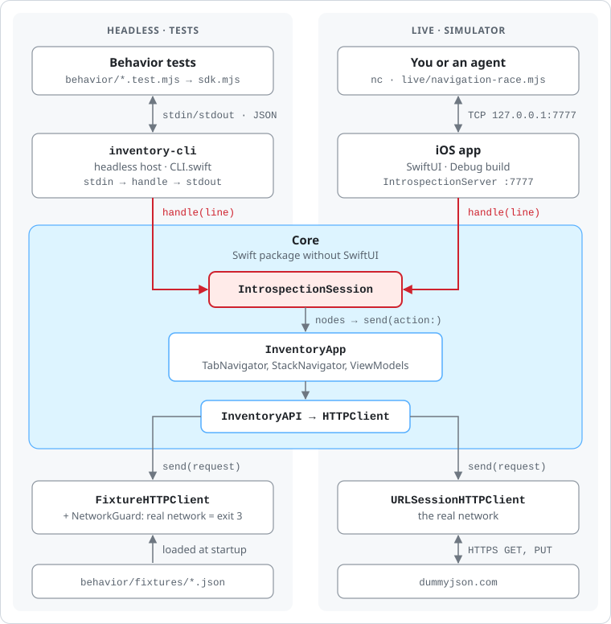
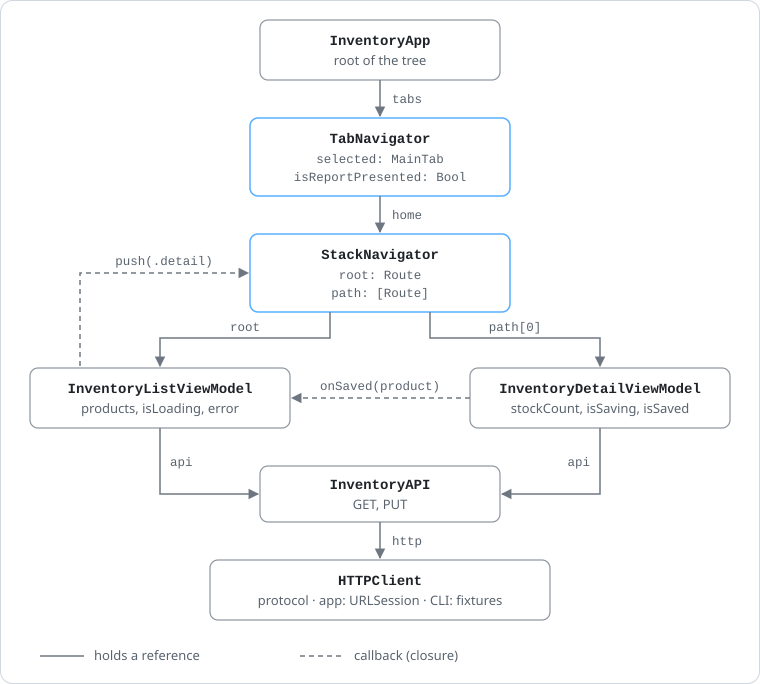
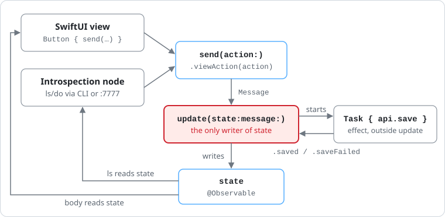
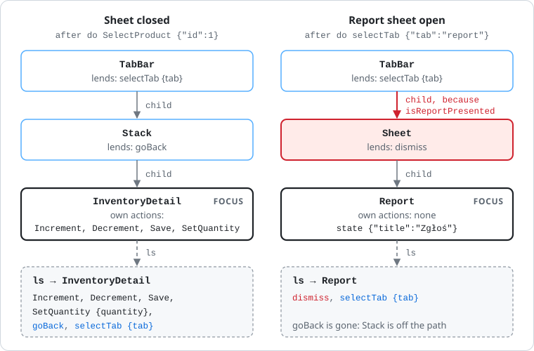
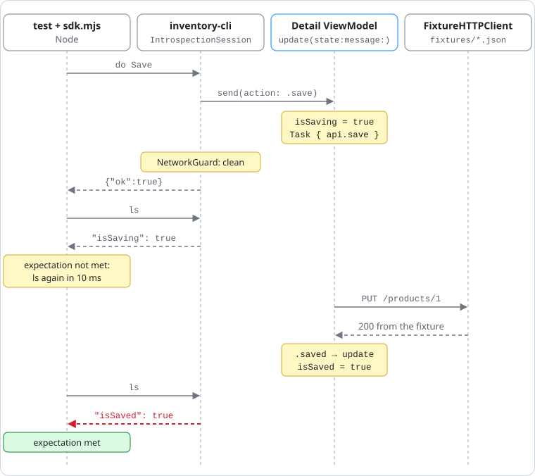
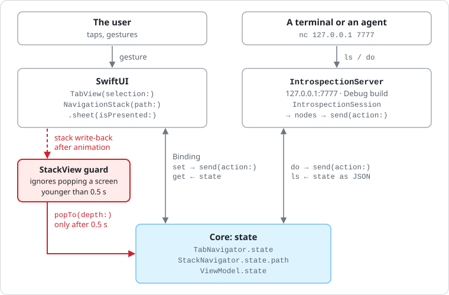

# Inside ReflexArchitecture

**English** · [Polski](README.pl.md)

*An architecture prototype · iOS · Swift 6*

ReflexArchitecture is a small iOS app built to try out, in practice, the [Reflex architecture described by Shopify](https://shopify.engineering/reflex). The app's logic runs without a screen, every screen is visible from the outside as JSON state with a list of actions, and tests drive the app from the terminal. Below: where everything lives, how each layer works, and what happens in the code, step by step. All code excerpts and test output come from this repository.

- Code as of: `main` @ `dfc6066`
- Example: an inventory backed by DummyJSON, plus the tab bar from ~/TabBar
- 8 Swift tests · 14 Node tests

## Four pillars

| Pillar | What it means | Where |
| --- | --- | --- |
| **A headless Core** | All logic lives in a Swift package that imports neither SwiftUI nor UIKit. It builds with a plain `swift build` and runs in a terminal process. | [`Core/Sources/InventoryCore`](Core/Sources/InventoryCore) |
| **An Elm-style ViewModel** | A screen is `State`, `Action`, `Message`, and a single `update` function, which is the only thing that changes state. | [`ViewModel.swift`](Core/Sources/InventoryCore/ViewModel.swift) |
| **Introspection nodes** | Every screen is visible from the outside as a name, JSON state, and a list of actions. Containers add their own actions to the screen on top. | [`Core/Sources/IntrospectionKit`](Core/Sources/IntrospectionKit) |
| **CLI and behavior tests** | The `ls` and `do` commands drive the headless app in tests and, over port 7777, the running app in the simulator too. | [`behavior/`](behavior) · [`Core/Sources/InventoryCLI`](Core/Sources/InventoryCLI) |

## Contents

1. [Where things live](#1-where-things-live)
2. [A headless Core](#2-a-headless-core)
3. [ViewModel: one way in, one writer](#3-viewmodel-one-way-in-one-writer)
4. [Introspection nodes](#4-introspection-nodes)
5. [CLI and behavior tests](#5-cli-and-behavior-tests)
6. [The same app, live](#6-the-same-app-live)
7. [Step by step: the tab bar](#7-step-by-step-the-tab-bar)
8. [Numbers](#8-numbers)
9. [Limits of the prototype](#9-limits-of-the-prototype)
10. [Cheat sheet](#10-cheat-sheet)

## 1. Where things live

The repository has three parts. Dependencies point one way: the iOS app and the CLI depend on Core, and Core depends on nothing that draws a screen.

```text
ReflexArchitecture/
├── Core/                              SwiftPM package, zero UI
│   ├── Sources/IntrospectionKit/      the contract: node, action, ls/do session, :7777 server
│   ├── Sources/InventoryCore/         the logic: ViewModels, navigators, API, app root
│   ├── Sources/InventoryCLI/          headless host: stdin/stdout, fixtures, network guard
│   └── Tests/                         8 Swift tests of the contract itself
├── Mobile/                            the iOS app: SwiftUI views and server startup
├── behavior/                          Node tests, no dependencies at all
│   ├── sdk.mjs                        test session: precondition, do, close
│   ├── inventory.test.mjs             8 inventory journeys
│   ├── tabs.test.mjs                  5 tab bar journeys
│   ├── sdk.test.mjs                   1 test of the SDK itself
│   ├── fixtures/*.json                "network" responses for the CLI
│   └── live/navigation-race.mjs       manual test of the live app
├── cli                                runs the headless app
├── test                               runs all the tests
└── .claude/skills/reflex/SKILL.md     instructions for agents
```



**Fig. 1.** Two hosts build the same Core. The CLI feeds it responses from files and talks over stdin/stdout. The app gives it the real network and listens on port 7777. The way into Core is the same in both cases: `IntrospectionSession.handle(line)`.

The compiler guards the boundaries. `Core/Package.swift` exposes three products. The iOS app links only the two libraries, and the CLI is a separate executable:

[`Core/Package.swift`](Core/Package.swift) (excerpt)

```swift
let settings: [SwiftSetting] = [
    .defaultIsolation(MainActor.self),
    .enableUpcomingFeature("NonisolatedNonsendingByDefault"),
    .enableUpcomingFeature("InferIsolatedConformances"),
]
…
    products: [
        .library(name: "IntrospectionKit", targets: ["IntrospectionKit"]),
        .library(name: "InventoryCore", targets: ["InventoryCore"]),
        .executable(name: "inventory-cli", targets: ["InventoryCLI"]),
    ],
```

The whole package runs on the main actor by default (`defaultIsolation(MainActor.self)`). ViewModels live on the main thread anyway, so they need no annotation. Only value types that cross threads are marked `nonisolated`, such as `Product` and action inputs.

## 2. A headless Core

The app's root is `InventoryApp`. It builds the object tree and takes exactly one thing from outside: an `HTTPClient`, the network edge.

[`Core/Sources/InventoryCore/InventoryApp.swift`](Core/Sources/InventoryCore/InventoryApp.swift)

```swift
/// The root of the app's object tree. The iOS app and the CLI are two hosts that construct it.
public final class InventoryApp {
    public let tabs: TabNavigator

    public init(http: any HTTPClient) {
        let api = InventoryAPI(http: http)
        weak var stack: StackNavigator?
        let list = InventoryListViewModel(api: api) { stack?.push($0) }
        let home = StackNavigator(root: .list(list))
        stack = home
        tabs = TabNavigator(home: home)
    }
}
```

Both hosts build the same root. They differ in their HTTP client and in who reads the state: SwiftUI in the app, a text session in the CLI.

[`Mobile/ReflexArchitectureApp.swift`](Mobile/ReflexArchitectureApp.swift) (excerpt)

```swift
@State private var app = InventoryApp(http: URLSessionHTTPClient())
…
WindowGroup {
    RootView(tabs: app.tabs)
    …
}
```

[`Core/Sources/InventoryCLI/CLI.swift`](Core/Sources/InventoryCLI/CLI.swift) (excerpt)

```swift
NetworkGuard.install()
let session = IntrospectionSession(
    root: InventoryApp(http: FixtureHTTPClient(fixtures: fixtures)))
```



**Fig. 2.** The object tree after opening a product's details. The list doesn't know the navigator; it only gets a `push` function. The details screen doesn't know the list; it only gets `onSaved`. The tab placeholders and the “Zgłoś” (Report) sheet are not objects: their nodes are derived from `TabNavigator`'s state.

Two decisions let the same code run without a screen.

- **Navigation is Core state.** `StackNavigator` holds the path of screens, and `TabNavigator` holds the selected tab and whether the report sheet is open. A view never opens anything by itself; it only sends an action.
- **Nothing waits for a view's lifecycle.** The list starts loading in `init`, not in `onAppear`. A terminal has no `onAppear`, so if loading depended on it, the CLI would never start it.

[`Core/Sources/InventoryCore/InventoryListViewModel.swift`](Core/Sources/InventoryCore/InventoryListViewModel.swift) (excerpt)

```swift
/// Starts loading right away: no view lifecycle involved, so headless runs behave the same.
init(api: InventoryAPI, push: @escaping (Route) -> Void) {
    self.api = api
    self.push = push
    send(message: .load)
}
```

## 3. ViewModel: one way in, one writer

Every screen and every navigator has the same shape, described by a short protocol:

[`Core/Sources/InventoryCore/ViewModel.swift`](Core/Sources/InventoryCore/ViewModel.swift)

```swift
/// The one shape every screen (and the navigator) follows: actions in, state out.
///
/// - `State` holds everything the screen shows; views read it and nothing else.
/// - `Action` is the public surface, sent through `send(action:)`.
/// - `Message` is internal: `.viewAction(Action)` plus results coming back from services.
/// - `update(state:message:)` is the only writer of `state`. Effects start a `Task`
///   that reports back with `send(message:)`. `update` never reads `self.state`.
@MainActor protocol ViewModel: AnyObject {
    associatedtype State
    associatedtype Message
    var state: State { get set }
    func update(state: inout State, message: Message)
}

extension ViewModel {
    func send(message: Message) {
        update(state: &state, message: message)
    }
}
```



**Fig. 3.** The view and the introspection node come in through the same door: `send(action:)`. Only `update` changes state. An effect, here the save on the server, runs in a `Task` and comes back to `update` as a new message.

Here is what that looks like in the product details screen:

[`Core/Sources/InventoryCore/InventoryDetailViewModel.swift`](Core/Sources/InventoryCore/InventoryDetailViewModel.swift) (excerpt)

```swift
public struct State: Encodable {
    public let productId: Int
    public let title: String
    public var stockCount: Int
    public var isSaving = false
    public var isSaved = false
    public var error: String?
}

public enum Action {
    case increment, decrement, save
    case setQuantity(Int)
}

enum Message {
    case viewAction(Action)
    case saved
    case saveFailed
}
…
func update(state: inout State, message: Message) {
    switch message {
    case .viewAction(let action):
        guard !state.isSaving else { return }  // nothing changes while a save is in flight
        switch action {
        // Wrapping on purpose: stock from the backend can be Int.max/Int.min; the wrapped
        // result lands outside stockRange, so edit(_:to:) turns it into a no-op.
        case .increment: Self.edit(&state, to: state.stockCount &+ 1)
        case .decrement: Self.edit(&state, to: state.stockCount &- 1)
        case .setQuantity(let quantity): Self.edit(&state, to: quantity)
        case .save:
            state.isSaving = true
            state.error = nil
            let (id, stock) = (state.productId, state.stockCount)
            Task {
                do {
                    try await api.save(id: id, stock: stock)
                    send(message: .saved)
                } catch {
                    send(message: .saveFailed)
                }
            }
        }
    case .saved:
        state.isSaving = false
        state.isSaved = true
        onSaved(Product(id: state.productId, title: state.title, stock: state.stockCount))
    case .saveFailed:
        state.isSaving = false
        state.error = "Couldn't save"
    }
}
```

### What happens when you tap Save

1. The button in the view calls `viewModel.send(action: .save)`. A test does exactly the same through the node's `Save` action.
2. `send(action:)` wraps the action in `Message.viewAction(.save)` and calls `update`.
3. `update` sets `isSaving = true`, clears the error, and starts a `Task` that calls `api.save(id:stock:)`.
4. The server's answer comes back as a new message, `.saved` or `.saveFailed`, and goes through `update` again.
5. On `.saved`, the state gets `isSaved = true`, and `onSaved` hands the new count to the list. Back on the list, it already shows the saved value.

Edge cases are decided by `update`, never by the view or the node. While a save is in flight, edits do nothing (`guard !state.isSaving`). A count outside 0–999,999 is ignored, and `&+` and `&-` protect against overflow when the backend returns `Int.max`. Each of these rules has its own journey in [`behavior/inventory.test.mjs`](behavior/inventory.test.mjs).

The view only reads state and sends actions. Its only local state is the buffer for the number being typed:

[`Mobile/InventoryDetailView.swift`](Mobile/InventoryDetailView.swift) (excerpt)

```swift
struct InventoryDetailView: View {
    let viewModel: InventoryDetailViewModel
    @State private var quantity = ""  // the typing buffer, the only view-local state

    var body: some View {
        let state = viewModel.state
        Form {
            Section("Stock") {
                HStack {
                    Button("Decrease", systemImage: "minus.circle") { viewModel.send(action: .decrement) }
                    Spacer()
                    Text(state.stockCount, format: .number).font(.largeTitle.monospacedDigit())
                    Spacer()
                    Button("Increase", systemImage: "plus.circle") { viewModel.send(action: .increment) }
                }
                …
            }
            Section {
                Button("Save") { viewModel.send(action: .save) }
                    .disabled(state.isSaving)
                …
```

## 4. Introspection nodes

A node is a screen seen from the outside: a name, state that can be encoded as JSON, a list of actions, and optionally the node below it.

[`Core/Sources/IntrospectionKit/IntrospectionNode.swift`](Core/Sources/IntrospectionKit/IntrospectionNode.swift) (excerpt)

```swift
/// A screen (or a container of screens) seen from outside the app:
/// a name, its state as JSON, the actions it accepts, and the node below it.
@MainActor public protocol IntrospectionNode {
    var name: String { get }
    var state: any Encodable { get }
    var actions: [IntrospectionAction] { get }
    var child: (any IntrospectionNode)? { get }
}
```

The details screen exposes its state as is, plus one action per `Action` case:

[`Core/Sources/InventoryCore/InventoryDetailViewModel+Introspection.swift`](Core/Sources/InventoryCore/InventoryDetailViewModel+Introspection.swift)

```swift
extension InventoryDetailViewModel: IntrospectionProviding {
    public var introspectionNode: any IntrospectionNode { Node(viewModel: self) }

    private struct Node: IntrospectionNode {
        let viewModel: InventoryDetailViewModel
        let name = "InventoryDetail"
        var state: any Encodable { viewModel.state }
        var actions: [IntrospectionAction] {
            [
                IntrospectionAction("Increment") { viewModel.send(action: .increment) },
                IntrospectionAction("Decrement") { viewModel.send(action: .decrement) },
                IntrospectionAction("Save") { viewModel.send(action: .save) },
                IntrospectionAction("SetQuantity", input: SetQuantityInput.self) {
                    viewModel.send(action: .setQuantity($0.quantity))
                },
            ]
        }
    }
}

nonisolated struct SetQuantityInput: IntrospectionInput {
    let quantity: Int
    static let fields = ["quantity"]
}
```

> **Node rules.** If the user can see it, it's in the state. If the user can do it, it's an action. Every action is always listed, with no `if`, and only calls `send(action:)`. Whether an action changes anything is up to `update`.

### Containers lend actions

Navigators are nodes too, but they have no screen of their own. Their actions are lowercase (`goBack`, `selectTab`, `dismiss`) because they reach the screen on top as borrowed actions. The `child` property says what is underneath. In the tab bar, that depends on the state:

[`Core/Sources/InventoryCore/TabNavigator+Introspection.swift`](Core/Sources/InventoryCore/TabNavigator+Introspection.swift) (excerpt)

```swift
private struct Node: IntrospectionNode {
    let navigator: TabNavigator
    let name = "TabBar"
    var state: any Encodable { navigator.state }
    var actions: [IntrospectionAction] {
        [
            IntrospectionAction("selectTab", input: SelectTabInput.self) {
                navigator.send(action: .selectTab($0.tab))
            },
        ]
    }
    var child: (any IntrospectionNode)? {
        if navigator.state.isReportPresented { return Sheet(navigator: navigator) }
        let tab = navigator.state.selected
        return tab == .home ? navigator.home.introspectionNode : Placeholder(tab: tab)
    }
}

/// Lends dismiss to the report, so dismiss exists only while the sheet is up.
private struct Sheet: IntrospectionNode {
    let navigator: TabNavigator
    let name = "Sheet"
    var state: any Encodable { [String: String]() }
    var actions: [IntrospectionAction] {
        [IntrospectionAction("dismiss") { navigator.send(action: .dismissReport) }]
    }
    var child: (any IntrospectionNode)? { Placeholder(tab: .report) }
}
```

The session follows `child` down to the deepest node. That node has the focus: `ls` shows its name and state. Actions are collected along the whole path: its own first, then the ancestors', nearest first:

[`Core/Sources/IntrospectionKit/IntrospectionSession.swift`](Core/Sources/IntrospectionKit/IntrospectionSession.swift) (excerpt)

```swift
/// The deepest node, and every action available there: its own first,
/// then each ancestor's, nearest first; a title already taken is skipped.
private func focus() -> (node: any IntrospectionNode, actions: [IntrospectionAction]) {
    var chain = [root.introspectionNode]
    while let child = chain[chain.count - 1].child { chain.append(child) }
    var taken = Set<String>()
    let actions = chain.reversed().flatMap(\.actions).filter { taken.insert($0.title).inserted }
    return (chain[chain.count - 1], actions)
}
```



**Fig. 4.** The same app before and after opening the report sheet. Exactly one thing changes: the tab bar's `child`. With it, `goBack` disappears and `dismiss` appears, even though no action list contains an `if`. In the `ls` results, borrowed actions take the color of the container that lends them.

### Action input

An action with data receives a JSON object and decodes it into an `IntrospectionInput` type. Bad data fails before it ever reaches the ViewModel. For tabs, the error lists the valid values right away:

[`Core/Sources/InventoryCore/TabNavigator+Introspection.swift`](Core/Sources/InventoryCore/TabNavigator+Introspection.swift) (excerpt)

```swift
nonisolated struct SelectTabInput: IntrospectionInput {
    let tab: MainTab
    static let fields = ["tab"]

    private enum CodingKeys: CodingKey { case tab }

    /// An unknown tab is refused with the list of tabs, so whoever sent it can correct it.
    init(from decoder: any Decoder) throws {
        let container = try decoder.container(keyedBy: CodingKeys.self)
        let name = try container.decode(String.self, forKey: .tab)
        guard let tab = MainTab(rawValue: name) else {
            let tabs = MainTab.allCases.map(\.rawValue).joined(separator: ", ")
            throw DecodingError.dataCorruptedError(
                forKey: .tab, in: container, debugDescription: #"unknown tab "\#(name)"; tabs: \#(tabs)"#)
        }
        self.tab = tab
    }
}
```

```text
do selectTab {"tab":"settings"}
error: selectTab expects {tab}: unknown tab "settings"; tabs: home, search, favorites, profile, report
```

## 5. CLI and behavior tests

### The protocol: two commands

`ls` shows the focused screen. `do <Action> [json]` runs one of the actions that `ls` just listed. A plain text line gets an answer meant for reading:

```console
$ printf 'ls\ndo SelectProduct {"id":1}\ndo selectTab {"tab":"report"}\nls\ndo dismiss\nls\n' | ./cli
InventoryList
  state   {"isLoading":false,"products":[{"id":1,"stock":99,"title":"Essence Mascara Lash Princess"},…]}
  actions SelectProduct {id}, goBack, selectTab {tab}
ok
ok
Report
  state   {"title":"Zgłoś"}
  actions dismiss, selectTab {tab}
ok
InventoryDetail
  state   {"isSaved":false,"isSaving":false,"productId":1,"stockCount":99,"title":"Essence Mascara Lash Princess"}
  actions Increment, Decrement, Save, SetQuantity {quantity}, goBack, selectTab {tab}
```

A line that starts with `{` is a JSON request. It gets a one-line JSON answer, and that is the mode the tests use:

```text
{"cmd":"ls"}
{"actions":[{"fields":["id"],"title":"SelectProduct"},{"fields":[],"title":"goBack"},{"fields":["tab"],"title":"selectTab"}],"name":"InventoryList","state":{"isLoading":false,"products":[{"id":1,"stock":2,"title":"Essence Mascara Lash Princess"}]}}
{"cmd":"do","action":"SelectProduct","payload":{"id":1}}
{"ok":true}
```

### The headless host

`inventory-cli` reads commands from stdin and writes each answer to stdout right away. Reading is asynchronous, so effects such as a save on the server can run between commands:

[`Core/Sources/InventoryCLI/CLI.swift`](Core/Sources/InventoryCLI/CLI.swift) (excerpt)

```swift
NetworkGuard.install()
let session = IntrospectionSession(root: InventoryApp(http: FixtureHTTPClient(fixtures: fixtures)))
// Async reading lets effects (service Tasks) run between commands.
for try await line in FileHandle.standardInput.bytes.lines
where !line.trimmingCharacters(in: .whitespaces).isEmpty {
    let answer = session.handle(line)
    let violations = NetworkGuard.violations
    if !violations.isEmpty {
        fail(violations.map { "network violation: \($0)" }.joined(separator: "\n"), code: 3)
    }
    // Unbuffered on purpose: a piped stdout would otherwise hold answers back.
    FileHandle.standardOutput.write(Data((answer + "\n").utf8))
}
```

Fixtures replace the network. The key is the method plus the path with its query; the value is a status, optionally with a body and a delay. A test loads several small files at once, and for the same key the later one wins:

[`behavior/fixtures/Inventory.stockCount2.json`](behavior/fixtures/Inventory.stockCount2.json)

```json
{
  "GET /products?limit=20&select=title,stock": {
    "status": 200,
    "body": { "products": [{ "id": 1, "title": "Essence Mascara Lash Princess", "stock": 2 }], "total": 1, "skip": 0, "limit": 20 }
  }
}
```

[`behavior/fixtures/Inventory.saveSlow.json`](behavior/fixtures/Inventory.saveSlow.json)

```json
{ "PUT /products/1": { "status": 200, "delayMs": 500 } }
```

Zero network is enforced. `NetworkGuard` intercepts every real request, and `FixtureHTTPClient` records every request that has no fixture. The CLI then exits with code 3, even if the app handled the error:

```console
$ printf 'do SelectProduct {"id":1}\ndo Save\nls\n' | ./cli behavior/fixtures/Inventory.stockCount2.json
ok
ok
network violation: missing fixture: PUT /products/1
$ echo $?
3
```

### The test SDK

[`behavior/sdk.mjs`](behavior/sdk.mjs) starts the CLI as a child process and talks to it in JSON. It has no dependencies beyond Node. Tests use three methods:

- `precondition(name, check)` waits until the focused screen has that name and passes the check.
- `do({ action, payload, expectation })` runs the action, then asks `ls` every 10 ms until the expectation stops throwing. After 2 s the test fails and shows the last state it saw.
- `close()` asks the CLI one more time, so that a network violation caused by the last step fails the test too.

[`behavior/sdk.mjs`](behavior/sdk.mjs) (excerpt)

```javascript
// Polls ls until check(node) stops throwing. A dead process fails at once (ls rejects);
// only failures thrown by the check are retried.
async function until(check) {
  const deadline = Date.now() + TIMEOUT_MS;
  for (;;) {
    const node = await ls();
    try {
      check(node);
      return node;
    } catch (error) {
      if (Date.now() >= deadline) {
        error.message += `\nlast seen: ${JSON.stringify(node)}`;
        throw error;
      }
    }
    await new Promise((resolve) => setTimeout(resolve, POLL_MS));
  }
}
…
  async do({ action, payload, expectation }) {
    const answer = await request({ cmd: 'do', action, payload });
    if (answer.error) throw new Error(`do ${action} refused: ${answer.error}`);
    if (expectation) await until(expectation);
  },
```

### A test, from the inside

The first journey in [`behavior/inventory.test.mjs`](behavior/inventory.test.mjs) walks the whole save path. The `stockCount2` and `saveSucceeds` fixtures provide one product with a stock of 2 and a successful `PUT`:

[`behavior/inventory.test.mjs`](behavior/inventory.test.mjs) (excerpt)

```javascript
// Every journey starts on the loaded list and opens one product.
async function openInventoryDetail(session, id = 1) {
  await session.precondition('InventoryList', ({ state }) => assert.equal(state.isLoading, false));
  await session.do({
    action: 'SelectProduct',
    payload: { id },
    expectation: ({ name, state }) => {
      assert.equal(name, 'InventoryDetail');
      assert.equal(state.productId, id);
    },
  });
}

test('given save succeeds, the user can adjust the quantity and save it', async (t) => {
  const session = createBehaviorSession({
    fixtures: [fixture('Inventory.stockCount2'), fixture('Inventory.saveSucceeds')],
  });
  t.after(() => session.close());
  await openInventoryDetail(session);

  await session.do({ action: 'Decrement', expectation: ({ state }) => assert.equal(state.stockCount, 1) });
  await session.do({ action: 'Decrement', expectation: ({ state }) => assert.equal(state.stockCount, 0) });
  // Decrement is always listed; the ViewModel decides it does nothing at zero
  await session.do({ action: 'Decrement', expectation: ({ state }) => assert.equal(state.stockCount, 0) });
  await session.do({
    action: 'SetQuantity',
    payload: { quantity: 40 },
    expectation: ({ state }) => assert.equal(state.stockCount, 40),
  });
  await session.do({ action: 'Save', expectation: ({ state }) => assert.equal(state.isSaved, true) });
  // any edit after a save makes the screen unsaved again
  await session.do({
    action: 'Increment',
    expectation: ({ state }) => {
      assert.equal(state.stockCount, 41);
      assert.equal(state.isSaved, false);
    },
  });
  await session.do({ action: 'Save', expectation: ({ state }) => assert.equal(state.isSaved, true) });
  // back on the list, the product shows what was saved
  await session.do({
    action: 'goBack',
    expectation: ({ name, state }) => {
      assert.equal(name, 'InventoryList');
      assert.equal(state.products.find((p) => p.id === 1).stock, 41);
    },
  });
});
```

Here is the `Save` step of that journey, from the inside:



**Fig. 5.** One step: `session.do({ action: 'Save', … })`. The test sends each command as a single JSON line, such as `{"cmd":"do","action":"Save"}`, and `inventory-cli` passes it to `IntrospectionSession`. An `ok` answer only means the action was accepted. The result is decided by the expectation, which the SDK checks by repeating `ls`. The order can vary: without a delay in the fixture, the save usually finishes before the first `ls`. The test assumes neither; it simply keeps asking.

## 6. The same app, live

In a Debug build the app starts an `IntrospectionServer`. Underneath is the same `IntrospectionSession` as in the CLI; only the commands arrive over TCP. They reach the running app's ViewModels, so the screen shows their effect immediately.

[`Core/Sources/IntrospectionKit/IntrospectionServer.swift`](Core/Sources/IntrospectionKit/IntrospectionServer.swift) (excerpt)

```swift
public init(port: UInt16, session: IntrospectionSession) throws {
    // Loopback only: reachable from this Mac (a simulator shares its network), never from the LAN.
    // acceptLocalOnly would be the obvious knob, but the iOS simulator silently drops those
    // connections (its NECP setup fails: "SO_NECP_LISTENUUID failed").
    let parameters = NWParameters.tcp
    parameters.requiredLocalEndpoint = .hostPort(host: .ipv4(.loopback), port: NWEndpoint.Port(rawValue: port)!)
    listener = try NWListener(using: parameters)
    self.session = session
}
```

[`Mobile/ReflexArchitectureApp.swift`](Mobile/ReflexArchitectureApp.swift) (excerpt)

```swift
#if DEBUG
/// `nc localhost 7777` gives the same ls/do as the headless CLI, against the running app.
private func startServer() {
    guard server == nil else { return }
    do {
        server = try IntrospectionServer(port: 7777, session: IntrospectionSession(root: app))
        server?.start()
    } catch {
        print("IntrospectionServer could not start: \(error)")
    }
}
#endif
```

```console
$ printf 'do SelectProduct {"id":2}\ndo selectTab {"tab":"report"}\nls\n' | nc -w 1 127.0.0.1 7777
ok
ok
Report
  state   {"title":"Zgłoś"}
  actions dismiss, selectTab {tab}
```

The simulator then opens the second product's details with the report sheet on top, exactly as if you had tapped your way there.



**Fig. 6.** State lives in Core. SwiftUI reads it through `Binding.get` and reports gestures through `Binding.set`, which sends an action. The terminal comes in through the same door, over port 7777. The only filter sits on the path of the screen stack.

SwiftUI gets state through plain `Binding`s: `get` reads Core, and `set` turns a gesture into an action. Core decides what that action does:

[`Mobile/RootView.swift`](Mobile/RootView.swift) (excerpt)

```swift
TabView(selection: Binding(get: { tabs.state.selected }, set: { tabs.send(action: .selectTab($0)) })) {
    Tab(MainTab.home.title, systemImage: MainTab.home.icon, value: MainTab.home) {
        StackView(navigator: tabs.home)
    }
    …
}
.tint(.red)
.sheet(isPresented: Binding(
    get: { tabs.state.isReportPresented },
    set: { if !$0 { tabs.send(action: .dismissReport) } }  // swiped down
)) {
    ReportSheet(tabs: tabs)
}
```

### Stale writes from SwiftUI

When an animation ends, SwiftUI writes back the stack of screens it is showing. When an agent sends actions faster than the animations run, that write can be stale and would pop a screen that was just opened. The manual test [`behavior/live/navigation-race.mjs`](behavior/live/navigation-race.mjs) lost 2 screens in 30 fast journeys. So `StackView` ignores a pop of any screen that SwiftUI has known for less than 0.5 s:

[`Mobile/StackView.swift`](Mobile/StackView.swift) (excerpt)

```swift
set: { newPath in
    // SwiftUI writes back the stack it displays when a transition ends. When Core has
    // moved on meanwhile (an agent pushing faster than the animations), that write is
    // stale. A person can only pop screens that finished coming in, so a pop that would
    // remove a screen SwiftUI learned about less than 0.5 s ago is ignored.
    // ponytail: time-based; a navigation delegate reporting only interactive pops would be exact.
    let removed = navigator.state.path.dropFirst(newPath.count)
    let settled = removed.allSatisfy { route in
        firstSeen.at[route].map { Date.now.timeIntervalSince($0) > 0.5 } ?? false
    }
    if settled { navigator.send(action: .popTo(depth: newPath.count)) }
}
```

After that change the test loses 0 screens in 120 journeys, inside the tab bar as well. Tabs and the sheet needed no protection of their own: 60 fast tab switches and 60 sheet openings over port 7777 produced no mismatch between Core and the screen.

## 7. Step by step: the tab bar

The architecture shows best when you add a feature. The tab bar was built in the order below. Steps 2 to 5 need no simulator, and each test run takes under a second.

### Step 1. Describe the behavior

First, in conversation: five tabs as in ~/TabBar, Home with the inventory, “Zgłoś” (Report) opens a sheet instead of switching tabs, and Core holds the selected tab. Plus five journeys that must work.

### Step 2. Tests before code

[`behavior/tabs.test.mjs`](behavior/tabs.test.mjs) describes those journeys in the language of actions. The helpers and one of the journeys:

[`behavior/tabs.test.mjs`](behavior/tabs.test.mjs) (excerpt)

```javascript
function startOnHome(t) {
  const session = createBehaviorSession({ fixtures: [fixture('Inventory.stockCount2')] });
  t.after(() => session.close());
  return session;
}

const selectTab = (session, tab, expectation) => session.do({ action: 'selectTab', payload: { tab }, expectation });
…
test('Zgłoś opens the report over the current tab, and closing it returns there', async (t) => {
  const session = startOnHome(t);
  await openProduct(session);
  await selectTab(session, 'report', ({ name, state }) => {
    assert.equal(name, 'Report');
    assert.deepEqual(state, { title: 'Zgłoś' });
  });
  await session.do({
    action: 'dismiss',
    expectation: ({ name, state }) => {
      assert.equal(name, 'InventoryDetail');
      assert.equal(state.productId, 1);
    },
  });
  // the same over a placeholder tab
  await selectTab(session, 'profile', ({ name }) => assert.equal(name, 'Profile'));
  await selectTab(session, 'report', ({ name }) => assert.equal(name, 'Report'));
  await session.do({ action: 'dismiss', expectation: ({ name }) => assert.equal(name, 'Profile') });
});
```

### Step 3. Red

Run before any code is written, the tests fail for the right reason: there is no `selectTab` action yet.

```console
$ node --test behavior/tabs.test.mjs
not ok 1 - the app opens on Home, and each tab shows its own screen
  error: 'do selectTab refused: unknown action "selectTab"; available: SelectProduct {id}, goBack'
not ok 2 - switching tabs keeps Home where the user left it
  error: 'do selectTab refused: unknown action "selectTab"; available: Increment, Decrement, Save, SetQuantity {quantity}, goBack'
…
# pass 0
# fail 5
```

### Step 4. Logic in Core

`TabNavigator` gets its state, actions, and `update`, and the rules from the description go into `update`. The tab bar's node was shown earlier, in the section on nodes.

[`Core/Sources/InventoryCore/TabNavigator.swift`](Core/Sources/InventoryCore/TabNavigator.swift) (excerpt)

```swift
func update(state: inout State, message: Message) {
    switch message {
    case .viewAction(.selectTab(let tab)):
        guard !state.isReportPresented else { return }  // the sheet covers the tab bar
        if tab == .report {
            state.isReportPresented = true
        } else if tab != state.selected {
            state.selected = tab
        } else if tab == .home {
            home.send(action: .popTo(depth: 0))  // the selected tab tapped again: back to its first screen
        }
    case .viewAction(.dismissReport):
        state.isReportPresented = false
    }
}
```

### Step 5. Green

```console
$ node --test behavior/tabs.test.mjs
ok 1 - the app opens on Home, and each tab shows its own screen
ok 2 - switching tabs keeps Home where the user left it
ok 3 - tapping the selected tab again takes it back to its first screen
ok 4 - Zgłoś opens the report over the current tab, and closing it returns there
ok 5 - tab actions that make no sense change nothing
# pass 5
# fail 0
```

Then the full `./test`: 8 Swift tests and 14 Node tests, all passing.

### Step 6. The view

Only now does `RootView` get a `TabView`, and the existing stack, with its race protection, moves unchanged into `StackView`. The view has no logic: a tap is `selectTab`, and the rest is reading state.

### Step 7. Check it live

A build in the simulator, the same actions over port 7777, then by hand: “Zgłoś”, Close, dragging the sheet down, tapping Home again, going Search → Home. Finally, fast loops and `navigation-race.mjs`, with 0 lost screens in 120.

### Step 8. Merge

Commit `dfc6066` on `main`.

## 8. Numbers

How long one lap of the change-and-check loop takes, with and without a screen:

| Measurement | Result | When |
| --- | ---: | --- |
| One headless journey: 12 commands, including starting the CLI process | 13 ms | 2026-11-10 |
| All Node tests: 14 tests, each in its own CLI process | 0.73 s | 2026-11-10 |
| `./test` after changing one file in Core: build, 8 Swift tests, 14 Node tests | 4.6–11 s | 2026-11-09 and 2026-11-10 |
| The same change in the simulator: build, install, launch, list loaded | 22.4 s | 2026-11-09 |
| 12 commands against the live app over port 7777 | ~99 ms | median, 2026-11-09 |

Shopify's article quotes a few hundred milliseconds headless and about 2 s in the simulator. It is faster here because the example is much smaller. The proportion holds: without a screen the loop is several times shorter, and a single journey costs milliseconds.

## 9. Limits of the prototype

- `ls` shows only the focused screen. Container state, such as the selected tab and the depth of the stack, is not visible directly, only indirectly through the screen's name.
- The guard in `StackView` is time-based: popping a screen less than 0.5 s after it appeared is ignored. A navigation delegate that reports only the user's gestures would be more precise.
- The server on port 7777 runs only in Debug builds and only on 127.0.0.1. A physical iPhone needs port forwarding.
- Search, Favorites, Profile, and the “Zgłoś” sheet are placeholders with an icon and a title.
- iOS only. The test SDK accepts a path to another binary (the `cli` option), so the same test files could drive, say, an Android version. What would be shared is the tests, not the code.

## 10. Cheat sheet

```bash
./cli                                     # the headless app on the default fixtures
./cli behavior/fixtures/Inventory.stockCount2.json behavior/fixtures/Inventory.saveFails.json
./test                                    # Swift tests, CLI build, Node tests
node --test behavior/tabs.test.mjs        # a single test file
printf 'ls\n' | nc -w 1 127.0.0.1 7777    # the live app (Debug build in the simulator)
node behavior/live/navigation-race.mjs    # fast live journeys, counts lost screens
```

---

This describes the `main` branch at commit `dfc6066`. The architecture's definition: [Reflex on the Shopify Engineering blog](https://shopify.engineering/reflex). Instructions for agents working in this repository: [`.claude/skills/reflex/SKILL.md`](.claude/skills/reflex/SKILL.md).
